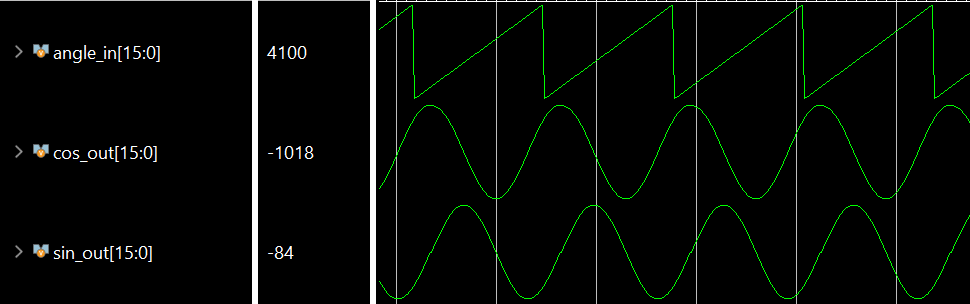

# CORDIC in SystemVerilog

Fixed-point hardware implementations of the CORDIC algorithm for computing
sine and cosine, together with testbenches.

## What is CORDIC?

CORDIC (**CO**ordinate **R**otation **DI**gital **C**omputer) computes
trigonometric functions using only **additions, subtractions and bit shifts**,
with no multipliers. That makes it a good fit for FPGAs and other simple
hardware.

The idea is to rotate the vector `(x, y) = (1, 0)` towards the target angle
`θ` in a series of smaller and smaller steps. In step `i` the vector is
rotated by `±atan(2^-i)`, and the direction is picked so that the
accumulated angle moves closer to `θ`:

```
x[i+1] = x[i] - d * (y[i] >>> i)
y[i+1] = y[i] + d * (x[i] >>> i)
z[i+1] = z[i] + d * atan(2^-i)        d = +1 if z[i] < θ, else -1
```

Because the rotation angles are `atan(2^-i)`, each multiplication by
`tan(angle)` becomes a right shift by `i`. The `atan(2^-i)` values come from a
small precomputed table.

After `N` steps `x ≈ cos(θ) / Kn` and `y ≈ sin(θ) / Kn`, where
`Kn ≈ 0.607` is a constant gain. Starting from `x = Kn` (or multiplying the
result by `Kn`) gives the final values.

CORDIC only converges for angles of roughly ±99°, so other angles are first
mapped into the range ±90°: subtract π (and negate the result) or 2π.

## Number format

Both designs use **16-bit signed fixed-point** values with **10 fractional
bits** (Q6.10), so `1.0 = 1024` and `π ≈ 3215`. Running 11 iterations
(`FXP_SHIFT + 1`) gives about 10 bits of accuracy.

## Repository contents

```
rtl/
  cordic.sv              Iterative (FSM-based) CORDIC
  cordic_pipelined.sv    Fully pipelined CORDIC
sim/
  cordic_tb.sv           Testbench for cordic.sv
  cordic_pipelined_tb.sv Testbench for cordic_pipelined.sv
```

### `rtl/cordic.sv`: iterative CORDIC

A single datapath that is reused for every iteration, controlled by an FSM:

1. Wait for `start`, then latch `angle_in`
2. Map the angle into the range ±90°
3. Run 11 CORDIC iterations, one per clock cycle
4. Apply the sign correction, write `sin_out` / `cos_out` and raise `ready_out`

It uses little hardware but produces only one result every ~15 clock cycles.

| Port        | Dir | Description                         |
|-------------|-----|-------------------------------------|
| `clock`     | in  | Clock                               |
| `reset`     | in  | Synchronous reset                   |
| `start`     | in  | Start a new calculation             |
| `angle_in`  | in  | Angle in radians, `0 .. 2π`         |
| `sin_out`   | out | Sine of the angle                   |
| `cos_out`   | out | Cosine of the angle                 |
| `ready_out` | out | Result is valid                     |

### `rtl/cordic_pipelined.sv`: pipelined CORDIC

Each CORDIC iteration is its own hardware stage (`cordic_step`). After the
pipeline fills up, it accepts a **new angle and produces a new result on every
clock cycle**.

Pipeline structure (latency: 18 clock cycles):

```
angle_in ─► quadrant ─► step 0 ─► step 1 ─► … ─► step 10 ─► mul_kn ─► sign ─► sin_out
            reduction                                       (5 stages) correction cos_out
```

- **Quadrant reduction**: maps the angle into the range ±90° and sets a
  "negate" flag that moves down the pipeline with the data
- **`cordic_step`**: one rotation step, with the shift amount set by the
  `STEP` parameter
- **`mul_kn`**: multiplies by `Kn` using shifts and adds
  (`621/1024 = 1 - 4 + 16 - 32 + 128 + 512`, divided by 1024)
- **Output stage**: applies the sign correction; `valid_out` goes high once
  the pipeline is full

| Port        | Dir | Description                         |
|-------------|-----|-------------------------------------|
| `clock`     | in  | Clock                               |
| `reset`     | in  | Synchronous reset                   |
| `ce`        | in  | Clock enable (stalls the pipeline)  |
| `angle_in`  | in  | Angle in radians, `0 .. 2π`         |
| `sin_out`   | out | Sine of the angle (18 cycles later) |
| `cos_out`   | out | Cosine of the angle (18 cycles later) |
| `valid_out` | out | Pipeline is full, output is valid   |

> Note: the `atan` table and the `mul_kn` constant are written for
> `FXP_SHIFT = 10`.

## Testbenches

Both testbenches sweep the angle from 0 to 2π in steps of 100 (≈ 0.1 rad)
for 10 periods and print each result:

```
Time: ... | Angle: ... deg | Sin: ... | Cos: ...
```

- **`cordic_tb.sv`**: pulses `start` for each angle and waits for `ready_out`.
- **`cordic_pipelined_tb.sv`**: feeds the pipeline a continuous stream of
  angles. It also includes a self-check: each output is compared with
  `$sin` / `$cos` of the angle that went in 18 cycles earlier (tolerance
  ±0.02), and a mismatch raises `$error`.

## Simulation results



